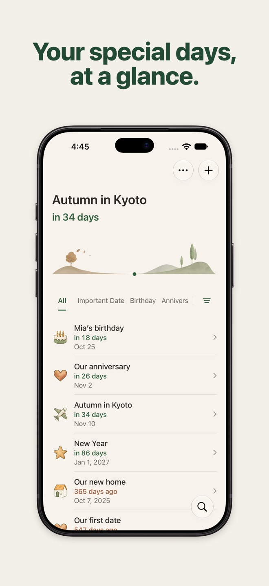
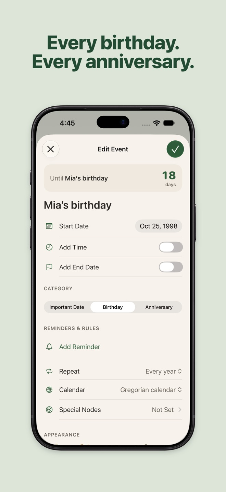
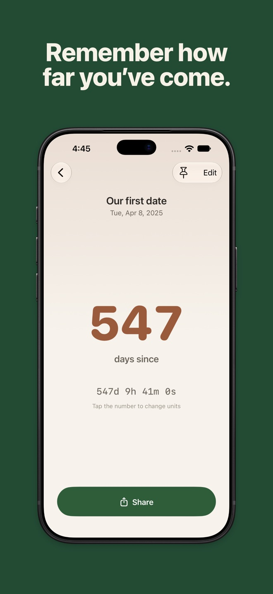
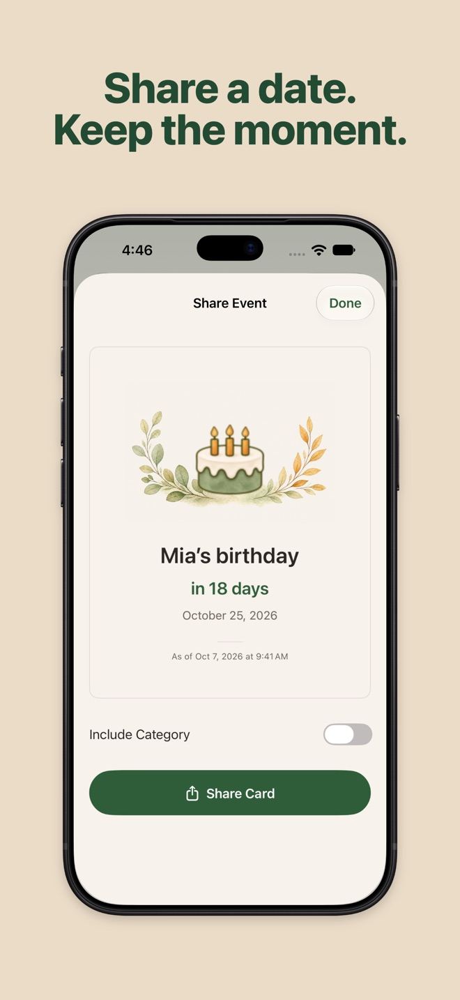
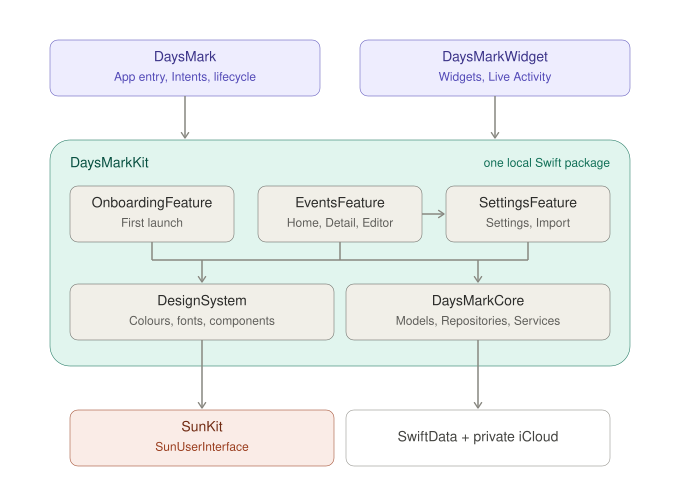

  

<h1 align="center">Daysmark</h1>

  Count down to the days ahead and count up from the days that matter. 
  An open-source countdown, birthday and anniversary app for iPhone and iPad.

  <strong>English</strong> · <a href="README.zh-CN.md">简体中文</a>

  
  
  
  

  
  
  
  

## What it does

How many days until the trip, the birthday, the wedding? How long since you met, moved or started
something new? Daysmark keeps them all in view.

- **Countdowns, birthdays and anniversaries** that repeat every year on their own
- **Reminders and milestones**, like 100 days to go or 1,000 days since
- **Widgets** for the Home Screen and Lock Screen, plus a Live Activity
- **Import** birthdays from Contacts and dates from Calendar
- **Siri, Shortcuts and Spotlight** to find, create and open dates
- **iPhone and iPad**, in English, German, Simplified Chinese, Japanese and Korean

No account, no ads, no tracking. Your dates stay on your device and in your own iCloud.

## Build from source

Requires Xcode 27 or later.

1. Clone the repository and open `DaysMark.xcodeproj`.
2. Choose the `DaysMark` scheme and an iPhone or iPad simulator, then run.

To run on a device, choose your team and replace the `com.example.daysmark` prefix in the bundle,
App Group and iCloud identifiers with your own.

## Code

Two Xcode targets share one local Swift package, with a module per target:

| Module | Responsibility |
|---|---|
| [`EventsFeature`](DaysMarkKit/Sources/EventsFeature) | Home, an event's detail, the editor and sharing; start reading at `Screens/Home` |
| [`SettingsFeature`](DaysMarkKit/Sources/SettingsFeature) | Settings, categories, import, notifications and recently deleted |
| [`OnboardingFeature`](DaysMarkKit/Sources/OnboardingFeature) | The first-launch flow |
| [`DesignSystem`](DaysMarkKit/Sources/DesignSystem) | Colours, fonts and the components every feature shares |
| [`DaysMarkCore`](DaysMarkKit/Sources/DaysMarkCore) | Dates and their calculation, the SwiftData models, repositories and services |

Every screen is a folder with its `View` and `ViewModel`; ViewModels read and write through
repository protocols that `AppDependencies` builds once. Swift 6 with strict concurrency, MVVM
with Observation, SwiftData with private CloudKit sync, Swift Testing (`scripts/test.sh`). How
the code is written — architecture, style, views, testing — is described in
[docs/spec](docs/spec/README.md).

## Licence

The source code is released under the [MIT License](LICENSE). The name Daysmark, the app icon,
the illustrations and the screenshots are not part of that licence (see [NOTICE](NOTICE)); all rights to them are
reserved, so please don't publish the app under the same name or artwork.

---

Made by Jiawen Sun · [sunapp24.com](https://sunapp24.com)
