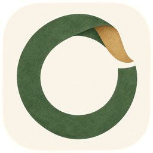
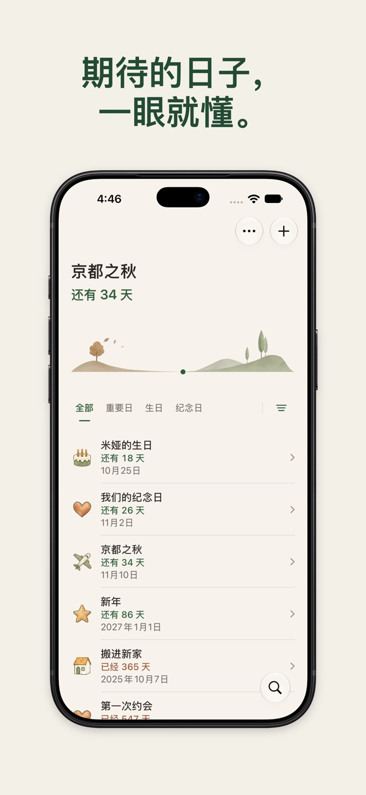
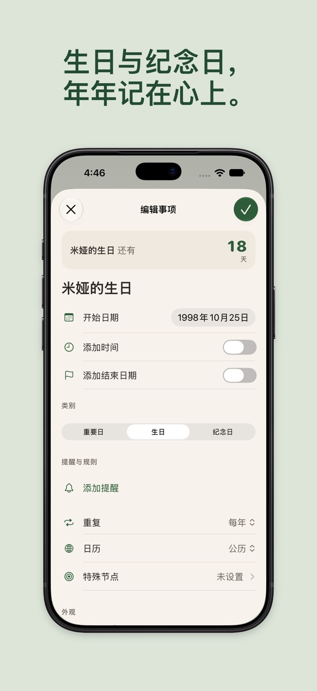
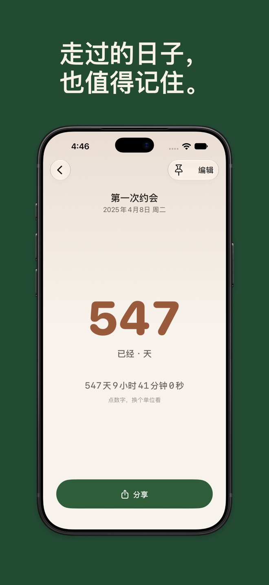
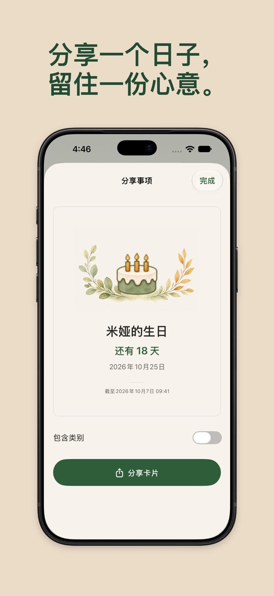
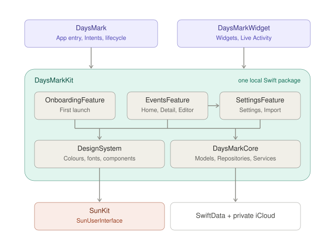

  

<h1 align="center">日子 Daysmark</h1>

  倒数即将到来的日子，正数已经过去的日子。 
  一款开源的倒数日、生日、纪念日 App，支持 iPhone 和 iPad。

  <a href="README.md">English</a> · <strong>简体中文</strong>

  
  
  
  

  
  
  
  

## 能做什么

离旅行、生日、婚礼还有几天？相识、搬家、开始一件新事已经多少天？日子帮你都记着。

- **倒数日、生日、纪念日**，每年自动重复
- **提醒与特殊节点**，比如还有 100 天、已经 1000 天
- **主屏幕和锁定屏幕小组件**，以及实时活动
- **导入**通讯录里的生日和日历里的日程
- **Siri、快捷指令和聚焦搜索**，查找、新建、打开日子
- **iPhone 与 iPad**，支持简体中文、英文、德文、日文、韩文

无需账号，没有广告，不做追踪。数据只保存在你的设备和你自己的 iCloud 中。

## 从源码构建

需要 Xcode 27 或更高版本。

1. 克隆仓库，打开 `DaysMark.xcodeproj`。
2. 选择 `DaysMark` scheme 和一台 iPhone 或 iPad 模拟器，运行。

要在真机上运行，选择你的开发团队，并把 Bundle、App Group 和 iCloud 标识里的
`com.example.daysmark` 前缀换成你自己的。

## 代码

两个 Xcode target 共用一个本地 Swift package，每个模块一个 target：

| 模块 | 职责 |
|---|---|
| [`EventsFeature`](DaysMarkKit/Sources/EventsFeature) | 首页、日子详情、编辑和分享；从 `Screens/Home` 开始读 |
| [`SettingsFeature`](DaysMarkKit/Sources/SettingsFeature) | 设置、分类、导入、通知和最近删除 |
| [`OnboardingFeature`](DaysMarkKit/Sources/OnboardingFeature) | 首次启动流程 |
| [`DesignSystem`](DaysMarkKit/Sources/DesignSystem) | 颜色、字体和各功能共用的组件 |
| [`DaysMarkCore`](DaysMarkKit/Sources/DaysMarkCore) | 日期与计算、SwiftData 模型、Repository 和服务 |

每个页面是一个文件夹，包含它的 `View` 和 `ViewModel`；ViewModel 通过 `AppDependencies` 统一创建的
Repository 协议读写数据。Swift 6 严格并发、MVVM + Observation、SwiftData + 私有 CloudKit 同步、
Swift Testing（`scripts/test.sh`）。代码怎么写——架构、风格、视图、测试——见 [docs/spec](docs/spec/README.md)。

## 许可

源代码以 [MIT 许可](LICENSE) 发布。「日子 / Daysmark」名称、App 图标、插画和截图不在许可范围内（见 [NOTICE](NOTICE)），
保留所有权利；请不要用同样的名称或素材发布 App。

---

作者：Jiawen Sun · [sunapp24.com](https://sunapp24.com)
