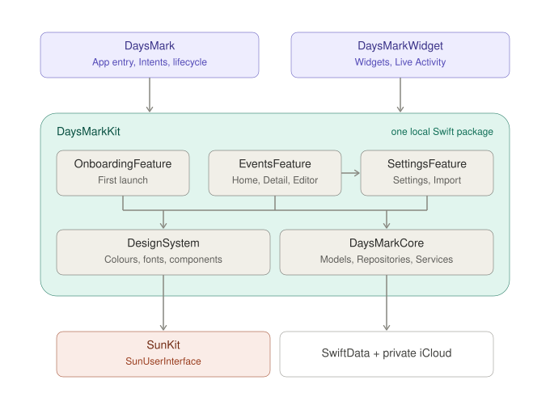

# Architecture

Daysmark keeps its data in SwiftData, syncs it through the user's private CloudKit database and
shows it in an app and a widget extension. There is no backend.



- iOS 26 or later, iPhone and iPad. iPhone is portrait; iPad supports every orientation.
- Swift 6 language mode, SwiftUI, Observation and SwiftData.
- MVVM per screen, features as targets of one local Swift package, `DaysMarkKit`.
- No analytics, no remote push, no in-app purchase. The only remote package is SunKit
  (`SunUserInterface`: routing and styling protocols), which is public.

## Modules

```text
DaysMark/          App target: composition root, app root, deep links, App Intents
DaysMarkWidget/    Widget extension: widgets and the Live Activity
DaysMarkTests/     Tests of DaysMark/
DaysMarkKit/
├── Sources/       EventsFeature, SettingsFeature, OnboardingFeature, DesignSystem, DaysMarkCore
└── Tests/         <Target>Tests per module, and TestSupport
```

| Module | May import | Never imports |
|---|---|---|
| App | every module, AppIntents, BackgroundTasks; SwiftData only to build the container | — |
| Widget | DaysMarkCore, DesignSystem, SunUserInterface, WidgetKit, ActivityKit, AppIntents | a feature |
| A feature | DesignSystem, DaysMarkCore, SunUserInterface; a feature it presents; SwiftData only in `Preview Content/` | a feature it does not present, WidgetKit |
| DesignSystem | SunUserInterface, SwiftUI | DaysMarkCore, any feature, SwiftData |
| DaysMarkCore | SwiftData, CoreData (for change notifications), the system frameworks its services wrap | SwiftUI, UIKit, any other module |

A dependency not in this table is not allowed; adding one changes the table and `Package.swift`
first.

- `EventsFeature` imports `SettingsFeature` to present `SettingsHostView`; nothing else imports
  a feature, and the graph has no cycles.
- Inside DaysMarkCore, `Models/` uses nothing outside `Models/`: models, values and calculation,
  no I/O. A repository uses the models and the store; a service uses the models, the repositories
  and the system framework it wraps.
- DaysMarkCore has `Models/`, `Persistence/`, `Repositories/` and `Services/`; what each owns is
  in [persistence.md](persistence.md).
- Every module is one target with one library product and one test target that depends on it and
  on `TestSupport`. `TestSupport` is not a product; the App never links it.
- DaysMarkCore and DesignSystem are linked into the widget extension, so they use only APIs an
  extension may call.

## No needless indirection

A reader follows a user action from the view to the database in three steps: the ViewModel's
intent, a repository method, the SwiftData models.

```text
View → ViewModel → Repository   stored data: EventRepository, CategoryRepository
                 → Service      a system framework, or work across several repositories
```

- **A ViewModel calls a repository directly** when it only reads or writes stored data. The
  protocol exists because the ViewModel's tests replace it with a spy.
- **One repository per kind of stored record**: a protocol and its SwiftData implementation
  (`EventRepository` and `SwiftDataEventRepository`). Each method is a few lines that call small
  internal steps (`EventDraftWriter`, `EventLifecycle`, `EventRevisionWriter`).
- **A service is for what a repository cannot do**: a system framework (`ReminderService`,
  `ImportService`, `SpotlightIndexer`) or work across repositories (`OnboardingService`). A
  service that changes stored data writes through the repositories; no service only forwards to
  one.
- **A protocol needs a reason**: a test replaces it, or a module boundary requires it
  (`SystemSurfaceRefreshing`). A protocol with one implementation that no test replaces is
  deleted.
- **One view and one ViewModel per screen.** No coordinator, manager, facade, factory, locator,
  use case or adapter types, and no `Application/` or `Infrastructure/` layer.
- A feature's `*Dependencies` is the one value that groups what is passed down.

## A feature from the outside

A feature exposes exactly two public types; everything else is `internal`.

```swift
public struct EventsDependencies { ... }   // what the App injects
public struct EventsHostView: View { ... } // the only view the App can show
```

The public host forwards to an internal `<Name>NavigationHost: FeatureHost`, which owns the router
and the root ViewModel with `@State`. `EventsHostView` also takes `request: Binding<AppRequest?>`:
the App sets it when a URL, a notification, Spotlight, an App Intent or a keyboard command asks
for something ([system-surfaces.md](system-surfaces.md#deep-links)).

## Navigation

SunKit routing, in each feature's `Navigation/`: `<Name>Dependencies`, `Destination`, `Router`,
`DestinationView`, `Routing`, `NavigationHost`.

- ViewModels navigate through a feature-local protocol (`EventsRouting`) that speaks in intents
  (`showDetail(for:)`, `showEditor(for:)`, `showSettings(_:)`), not destinations or paths.
- The router is the single source of the path and the presented sheet. A destination carries an
  ID or a small enum (`.detail(CountdownEvent.ID)`), never a model, a view or a draft.
- Home is the root. Detail and Settings are pushed; the editor and sharing are sheets. In regular
  width `EventsNavigationHost` shows a `NavigationSplitView` with Home in the sidebar, using the
  same router.
- A feature shows another feature's public host directly and carries its dependencies in its own
  (`let settings: SettingsDependencies`). No `AnyView`.

## The App and the widget extension

Each target compiles only its own folder; what they share is a DaysMarkKit module, never a file in
two targets. The entry point is the only Swift file at the top of its folder. Each target's
`Info.plist` and entitlements are in its `Configuration/` folder.

The App has `App/` (the entry point, `Composition/`, `Lifecycle/`, `Intents/`), `Root/`
(`AppRoot`, `AppRootViewModel` and how links and commands arrive), `Resources/` and
`Configuration/`. The widget has `Widgets/` (`Focus/`, `List/`), `LiveActivity/` and `Intents/`.

- `AppDependencies` builds the model containers and one instance of each repository and service,
  and builds each feature's dependencies in instance methods (`events()`, `settings()`,
  `onboarding(onComplete:)`).
- `AppRoot` shows Onboarding or `EventsHostView`, decided by `AppRootViewModel`.
- `AppLifecycle` seeds the built-in categories, runs `StoreRepair` and refreshes the system
  surfaces when the app becomes active and after every finished CloudKit import
  ([persistence.md](persistence.md#repair)).
- No singletons or `shared` instances. A system singleton (`UNUserNotificationCenter.current()`,
  `BGTaskScheduler.shared`) is used only inside the one type that wraps it.
- The widget extension only reads. It has no ViewModels: a provider asks DaysMarkCore's
  `Services/Widgets/` for content and a view lays it out with DesignSystem.

## Inside a feature

The public host is the only Swift file at the top, beside the module's `README.md`. Each screen is
a folder, nested the way screens are pushed.

```text
Sources/EventsFeature/
├── EventsHostView.swift
├── README.md
├── Navigation/
├── Screens/
│   ├── Home/            HomeView, HomeViewModel, Models/, Components/
│   ├── Detail/
│   ├── Editor/          … and SpecialNodes/, a screen pushed from the editor
│   ├── Sharing/
│   └── Models/          what several screens share: EventItem, CurrentTime
├── UserInterface/       Modifiers/, Extensions/: what only this feature reuses
├── Resources/
└── Preview Content/     PreviewObjectPool
```

- A type's display (titles, symbols, accessibility text) is an extension in the type's own file.
  For a type from another module it is in `UserInterface/Extensions/<Type>Extensions.swift`.
- Something used by two screens moves up to the closest folder both share; a view used by two
  features or by the widget moves to DesignSystem when it takes only plain values; a helper used
  by two modules moves down to the lowest module both depend on.
- DesignSystem and DaysMarkCore are peers. Mapping a domain value to a colour or a component
  (`DayCount.Direction.tint`, `DayCount.landscapeMarker`) lives in the module that uses it, in
  `UserInterface/Extensions/`.
- A test target mirrors its module's folders.
- A folder exists only once it has a file. No `Shared/`, `Helpers/`, `Utils/`, `Common/` or
  `Managers/` ([principles.md](principles.md#folders)).

## Every module runs on its own

Opening `DaysMarkKit/Package.swift` with the App closed builds each module, runs its tests and
renders every preview.

- A module never reads the App's bundle, catalog, assets or Info.plist; what it needs arrives
  through its `*Dependencies` or an initializer.
- `<Name>HostView.swift` ends with a preview built from the module's `PreviewObjectPool`, so the
  canvas runs the whole flow on an in-memory store.
- Every module has a `README.md` at the top of `Sources/<Target>/`: what the module is for and
  the public types a reader starts from.

## Isolation

| Module | Default isolation |
|---|---|
| App, widget, features, DesignSystem, TestSupport | `MainActor` |
| DaysMarkCore | nonisolated; every public value is `Sendable` |

- In a MainActor module, write no isolation keyword. `nonisolated` goes only on the narrowest
  declaration the compiler reports as used off the main actor.
- In DaysMarkCore, `@MainActor` marks what works on the main `ModelContext` and is called
  synchronously by the UI: the repositories, the services that use them, and their protocols.
  SwiftData models never cross an actor; what crosses is a value or an ID.
- A protocol whose work is asynchronous and off the main context (`NotificationScheduling`) is
  nonisolated and `Sendable`.
- Every module enables `MemberImportVisibility`, so each file imports exactly what it uses.

## Identifiers

Each stored or system identifier is written once, as a case of an enum with raw values beside the
code that uses it (`StoreIdentifier`, `WidgetKind`, `NotificationPayloadKey`), and a test pins
the raw values.

| What | Value |
|---|---|
| Bundle identifiers | `com.example.daysmark`, `com.example.daysmark.widget` |
| App Group | `group.com.example.daysmark` |
| iCloud container | `iCloud.com.example.daysmark` |
| URL scheme | `daysmark` ([system-surfaces.md](system-surfaces.md#deep-links)) |
| Background task | `com.example.daysmark.reminderRefresh` |
| Store files | `CountdownDays.store`, `CountdownDaysLocalSources` |
| Widget kinds | `HeroCountdownWidget`, `ImportantDatesListWidget` |

SwiftData model class names and stored property names (`CountdownEvent`, `EventCategory`, …) are
the CloudKit record types and fields, so they keep their names when the product's name changes.
